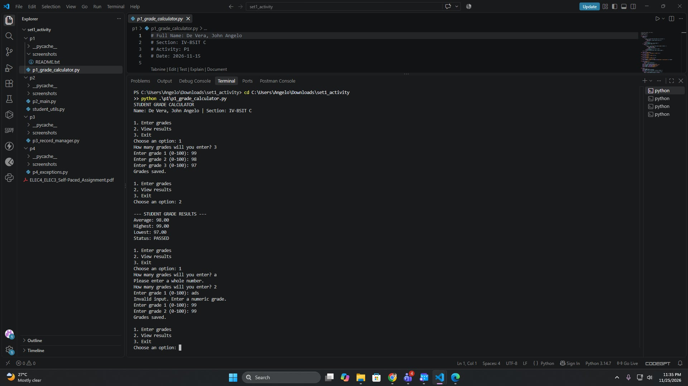
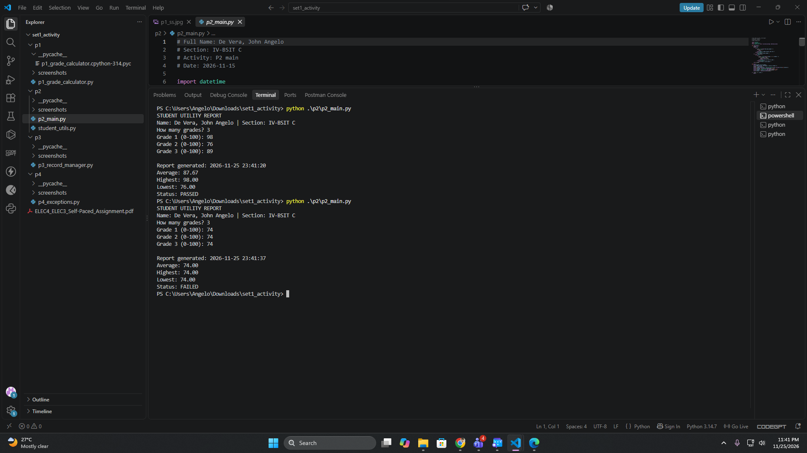
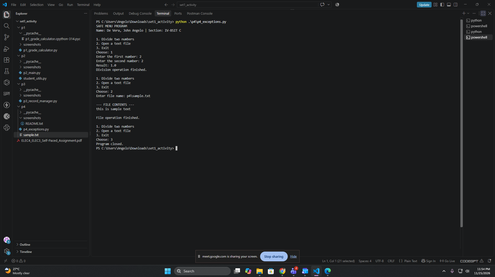

# ELEC4-Python-DeVera

**Full name:** De Vera, John Angelo  
**Section:** IV-BSIT C  
**Course code:** ELEC 4 - Python Programming  
**Course title:** Python Programming

## Set 1 Activities

| Activity | Description | Folder |
|---|---|---|
| P1 | Student Grade Calculator | [set1/p1](set1/p1) |
| P2 | Custom `student_utils` module | [set1/p2](set1/p2) |
| P3 | Student Record Manager | [set1/p3](set1/p3) |
| P4 | Safe Menu Program | [set1/p4](set1/p4) |

### P1 - Student Grade Calculator

Accepts and validates student grades, calculates the average, highest, and lowest grades, then determines whether the student passed or failed.

### P2 - Custom Module: Student Utilities

Uses a custom `student_utils` module to calculate grade statistics and demonstrate both module import styles.

### P3 - Student Record Manager

Adds, removes, searches, and displays student names using a list and set to preserve records and prevent duplicate entries.

### P4 - Safe Menu Program

Demonstrates exception handling for division by zero, invalid numeric input, missing files, and permission errors.

## How to Run

Run each command from the repository root:

```bash
python set1/p1/p1_grade_calculator.py
python set1/p2/p2_main.py
python set1/p3/p3_record_manager.py
python set1/p4/p4_exceptions.py
```

On Windows, you can use `py` instead of `python`.

## Screenshots

Screenshots for each activity are in their respective folders.

### P1 - Student Grade Calculator



### P2 - Custom Module: Student Utilities



### P3 - Student Record Manager


### P4 - Safe Menu Program



## Technologies Used

- Python
- Visual Studio Code
- Git
- GitHub

## Repository Organization

The repository contains four Python programming activities organized in the `set1/p1` through `set1/p4` folders. Each activity includes its source code; screenshots are saved in the corresponding `screenshots` folder.

The `.gitignore` file prevents Python cache files from being uploaded to the repository.
