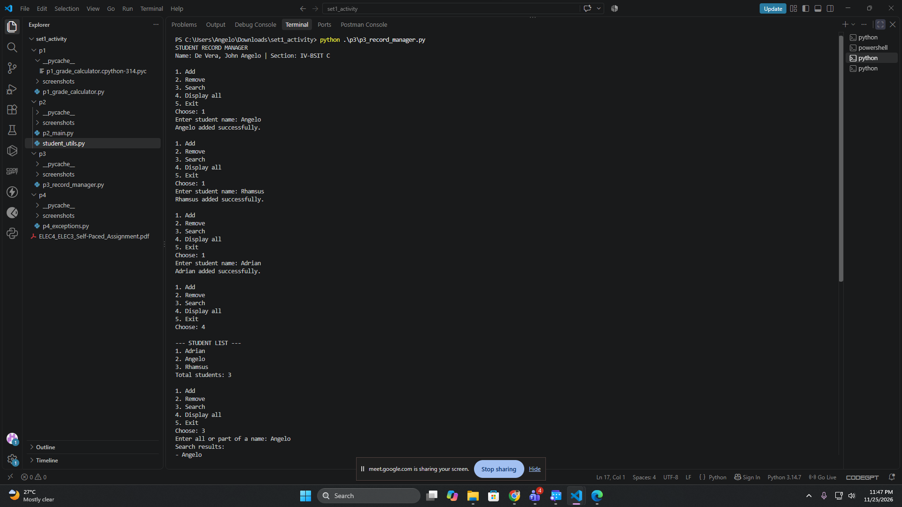
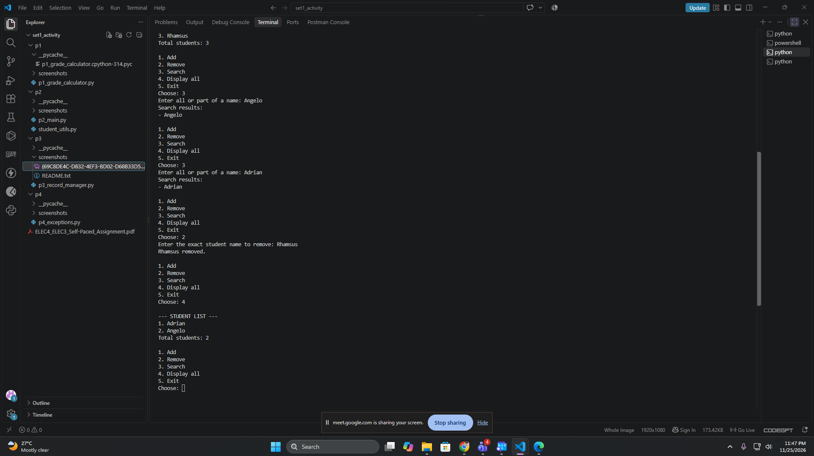

# ELEC4-Python-DeVera

**Full name:** De Vera, John Angelo  
**Section:** IV-BSIT C  
**Course code:** ELEC 4 - Python Programming  
**Course title:** Python Programming

## Set 1 Activities

| Activity | Description | Folder |
|---|---|---|
| P1 | Student Grade Calculator | [p1](p1) |
| P2 | Custom `student_utils` module | [p2](p2) |
| P3 | Student Record Manager | [p3](p3) |
| P4 | Safe Menu Program | [p4](p4) |

## How to Run

Run each command from the repository root:

```bash
python p1/p1_grade_calculator.py
python p2/p2_main.py
python p3/p3_record_manager.py
python p4/p4_exceptions.py
```

On Windows, you can use `py` instead of `python`.

## Screenshots

Screenshots for each activity are in their respective folders.

### P1 - Student Grade Calculator


### P2 - Custom Module: Student Utilities


### P3 - Student Record Manager





### P4 - Safe Menu Program


## Technologies Used

- Python
- Visual Studio Code
- Git
- GitHub

## Repository Organization

The repository contains four Python programming activities organized in the `p1` through `p4` folders. Each activity includes its source code; screenshots are saved in the corresponding `screenshots` folder.

The `.gitignore` file prevents Python cache files from being uploaded to the repository.
